# Information architecture

Phase 2 output. How the wiki is organised, why, and the rules every page follows. The page list itself is [`coverage.yaml`](coverage.yaml) (191 pages); the generated tracker is [`progress.md`](progress.md).

## Principles

1. **One question, one page.** A page answers one thing a player wants to know ("How do I capture a pet?"), not one official guide. Big official guides are split (the Pets guide becomes six pages); small related ones are merged (fortification and refinement each get a page, but both cite the same crafting guide).
2. **Two layers: systems and route.** Sections C–S are *system* pages: how one thing works. The *walkthrough* (section B) is the route: it tells you when to use each system and links to the system page for the details. Walkthrough stages never repeat a system page's tables; they link to them.
3. **Official names first.** Pages use the official English name (Ourosangue, Sangricoins, Quitina, Sangrulhos, Resonator). The brief's alternative wording and the Portuguese term go in the glossary and in the page's `description`, so search still finds them ("Chitin" → Quitina, "Act Souls" → pet souls).
4. **Both ways of playing.** Wherever the steps differ, a page shows two tabs: **With the interface** (panels and F-keys) and **Without the interface** (chat commands and numbered menus). This mirrors the official guides, 48 of which have both versions.
5. **Global by default.** Everything is assumed to apply to all Sangria Falls servers unless labelled `RPG 04 specific`.
6. **Honest coverage.** A page that isn't written shows a notice and links to the official guides. Generated tables and calculators only show figures an official page states.

## URL scheme

- `/<section>/` is the section overview; `/<section>/<page>/` is an article. All lowercase English, hyphenated, no Portuguese in URLs.
- Walkthrough stages are numbered so they sort correctly: `/walkthrough/07-prestige-1-10/`.
- Class pages use the class name: `/classes/la-muerte/`.
- Tools live under `/tools/`, so calculators can be linked from many articles.
- Headings get stable anchors (Starlight does this), so Discord links can point at a section: `/meditation/costs-and-rates/#double-meditation`.

## Sections

The sidebar follows the brief's sections A–S, with three adjustments:

| Sidebar section | Brief | Pages | Notes |
|---|---|---|---|
| About this wiki | — | 3 | Disclaimer, research method, labels, source registry |
| Getting started | A | 20 | Adds *Playing without the interface* and *The website panel* (official systems the brief doesn't list) |
| Progression walkthrough | B | 16 | Overview + 15 stages |
| Character progression | C | 9 | |
| Meditation | D | 8 | |
| Classes | E | 16 | Adds *Training Room*; evolutions get their own page because three classes depend on them |
| Equipment and builds | F | 16 | Six build pages are community recommendations by definition |
| Pets and Sangrulhos | G + H | 10 | Merged: both are collected companions, and readers compare them |
| Professions | I | 11 | |
| Economy | J | 12 | Adds *Casino*; *Prisoner market* moves here from R because it is a currency sink |
| Dungeons | K | 11 | |
| Events | L | 9 | |
| Outposts and quests | M | 6 | |
| Vampiric Schools | N | 3 | |
| Endgame | O | 6 | Adds *After 250 transfusions* (Kill Points), found in the sources |
| Battle Pass and VIP | P + Q | 6 | Merged: both are where optional purchases live |
| World and community | R | 11 | *Teleports* moves to Getting started, where new players need it |
| Reference | S | 12 | |
| Tools | §4 | 9 | Overview + eight calculators |

Every brief item maps to at least one page: each entry in `coverage.yaml` lists the brief items it covers in `brief`.

## Page types

| Type | Used for | Structure |
|---|---|---|
| **Section overview** | `/<section>/` | What the section covers, who it's for, the pages in reading order with their status, the official guides behind it |
| **System article** | Most pages | The brief's article format (§5): short explanation, quick facts, requirements, how to unlock, steps (interface / chat tabs), mechanics, rewards and costs, strategies, common mistakes, FAQ, commands, related guides. Sections that don't apply are left out. Sources and last-verified date are appended automatically. |
| **Walkthrough stage** | `/walkthrough/NN-…/` | The brief's stage format (§3B): objectives, prerequisites, steps, recommended gear and activities, NPCs, currency needed, rewards, mistakes, what to prioritise next, what can wait. Ends with *Next stage*. |
| **Class page** | `/classes/<class>/` | The brief's class template (§3E), translated from the Portuguese class page. Builds and rotations are labelled community. |
| **Reference table** | `/reference/…` | One searchable, filterable table per page, generated from data files in `src/data/`, so a number is stored once and reused by articles and calculators. |
| **Tool** | `/tools/…` | Inputs, results, the formula in plain words, and the sources for every constant. Inputs with no verified formula are disabled with an explanation. |

## Labels

Labels (see `src/data/labels.ts`) go in frontmatter for the whole page, or inline with `<Label type="…" />` next to one claim. Rules:

- A page whose facts all come from official pages gets `official`.
- Any recommendation, ranking or "best" advice is `community`, inline at the claim if the rest of the page is official.
- `verify` always comes with an open-question id or a note in `coverage.yaml`.
- `vip` and `purchase` mark the feature, not the page, unless the whole page is about it.

## Reading order and cross-links

`coverage.yaml` records `needs`: the pages a reader should know first. These drive:

- a *Before you read* line at the top of the page (Phase 3 component);
- *Related guides* at the bottom, together with pages sharing a source;
- the walkthrough order, which is checked for loops by `npm run coverage`.

## Unlock dependencies

The walkthrough order comes from the prerequisites the official guides state, not from the brief's suggested order. What the sources say (2026-11-22):

```mermaid
flowchart TD
  start[New character: quest 'Where am I?!'] --> pob[The Path of Blood]
  pob --> first[First class, free]
  pob --> other[Other classes: each Master's quest]
  first --> evo[Evolutions I–III: 15k / 30k / 45k Ourosangue]
  evo --> sangrael[Sangrael: Draekhar I]
  evo --> general[General: Umbrellis II, Mortak III, Bastien III]
  evo --> lamuerte[La Muerte: Draekhar III, Sepulkros III, Carmesyne II]
  first --> quitina[Quitina double XP usable]
  start --> baptism[Vlad Parker: The Blood Baptism] --> tp[Personal teleports, Sangria Bank teleport]
  tutorial[Starter tutorial finished] --> med[Meditation]
  lvl90[Character level 90] --> prestige[Prestige 1–20, Ourosangue]
  lvl90 --> judgment[Goreswine's Judgment, 3–5 players]
  lvl90 --> rupture[Reality Rupture]
  prestige --> p20[Prestige 20]
  p20 --> schools[Vampiric Schools, Sebastian]
  p20 --> call[Nyxaris: The Call of Blood] --> pulse[Pulses] --> tf[Transfusions: 10 Pulses + 10,000 Ourosangue] --> plasma[Plasmas]
  tf --> book[Lost Book chapters]
  tf --> kp[After 250: Kill Points]
  w100[Weapon or blood level 100] --> wfree[First prestige free via Vlad Parker]
  prof1[Craft profession prestige 1+] --> fort[Fortification up to prestige level]
  prof7[Craft prestige 7 / 9] --> refine[Up to 3 / 4 refinements]
  ach[Craft mentor's achievement] --> refine2[First 2 refinements at once; 5th at craft prestige 10]
  gath5[Gathering prestige 5] --> comp[Refining components drop]
  gath6[Gathering prestige 6–9] --> souls[Sacrificed Souls drop, one act per prestige]
  keys[Group of 2–4 + one key each] --> dungeon[Dungeons, enemies always level 90]
  eye[Eye of Twilight in a castle] --> incursion[Rift Incursion alerts]
  shop[5,000 Ourosangue once] --> market[Own market shop]
```

Gaps the walkthrough must handle without guessing: no level requirement is stated for dungeons (only that enemies are level 90), and nothing official says when a player is "ready" for each difficulty. Those parts are labelled community advice.

## Audience paths

The homepage and *Getting started* overview offer starting points per reader, all linking into the same pages:

| Reader | Start at | Then |
|---|---|---|
| New to V Rising | What is Sangria Falls? | Walkthrough from stage 1 |
| Vanilla V Rising player | Sangria Falls vs vanilla | First-day checklist |
| Bloodcraft player | Sangria Falls vs Bloodcraft | Character progression, Classes |
| Returning player | Progression requirements | The walkthrough stage that matches their prestige |
| Free-to-play | Free vs VIP progression | Earning guide |
| Endgame | Endgame overview | Plasmas, tools |

## Data files (Phase 3 onwards)

Numbers used in more than one place live once in `src/data/`, with the source id beside each value: prestige costs, evolution tributes, meditation rates, pet tier costs, key recipes, profession pay, transfusion costs. Articles render them through components, and calculators import the same files. This keeps the wiki and the tools from disagreeing.
